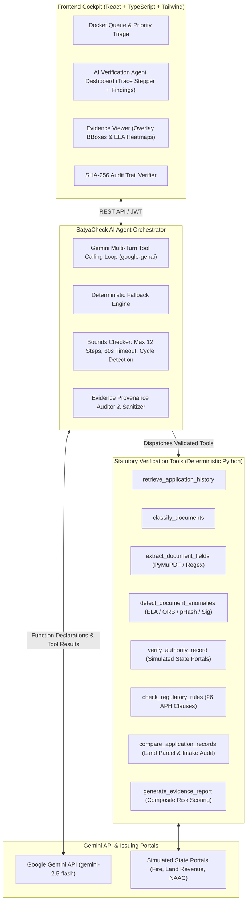
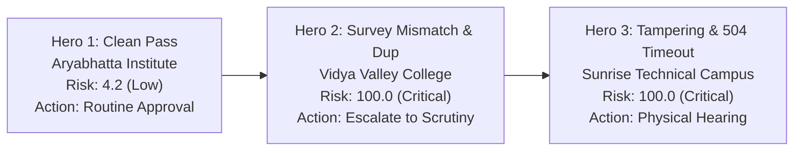

# SatyaCheck AI — LLM-Powered Regulatory Verification Agent
### AICTE Trust Layer: Autonomous Multi-Step Document Authentication & Regulatory Scrutiny

> **Smart India Hackathon (SIH) Prototype**  
> Problem Statement: *AI-Powered Application Validation, Document Authentication and Regulatory Compliance Verification for AICTE (Extension of Approval applications).*  
> Upgraded to **SatyaCheck AI**: A genuine tool-calling AI agent powered by Google Gemini (`google-genai`) with evidence-grounded verification.

---

## 1. Executive Summary & Product Philosophy

**SatyaCheck AI** is an intelligent regulatory decision-support platform designed to assist statutory scrutiny officers in evaluating AICTE Extension of Approval (EoA) applications. Rather than using an unstructured chatbot, SatyaCheck AI employs an autonomous, multi-step **Gemini Tool-Calling Agent** that interacts directly with verified deterministic computer vision detectors, statutory AICTE rule engines, and authority adapters.

### Core Operating Principles:
1. **Decision-Support Paradigm (Strictly No Auto-Rejection):** Under AICTE statutory governance norms, AI outputs serve exclusively as preliminary advisory indicators. Final administrative determinations belong solely to authorized human scrutiny officers.
2. **Evidence-Linked Provenance:** Every finding generated by the agent is bound to explicit bounding boxes (`[x0, y0, x1, y1]`), extracted vs. expected value differentials, backing tool names, and AICTE Approval Process Handbook (APH 2026) clause references. Gemini is prohibited from inventing or hallucinating values.
3. **Deterministic Authority Separation:** Mathematical calculations (faculty-to-student ratios, land acreage, computer ratios) and forensic pixel analyses (ELA, copy-move keypoints) are calculated exclusively by deterministic Python algorithms. The LLM interprets findings, orchestrates multi-step tool calls, and synthesizes executive dossiers.
4. **Resilient Dual-Mode Execution:** Operates seamlessly via **Gemini 2.5 Flash Tool Calling** when an API key is configured, and provides an instant **Deterministic Offline Fallback** when running offline, ensuring zero external vendor lock-in.
5. **Tamper-Evident Ledger:** Every rule evaluation, connector response, and human officer action is sealed into an immutable, hash-chained SHA-256 block sequence with active cryptographic integrity verification.

---

## 2. Agent Workflow & System Architecture



---

## 3. The 8 Statutory Tools & Responsibilities

The agent does not execute arbitrary code or shell commands. It selects exclusively from 8 registered, typed Python tools:

| # | Tool Name | Scope & Responsibilities | Backing Implementation |
|---|---|---|---|
| 1 | `retrieve_application_history` | Fetches historical institutional baseline, approved intake quotas, past deficiencies, and prior accreditation standings. | Queries `AICTEMasterRecord` and past audit snapshots. |
| 2 | `classify_documents` | Automatically classifies uploaded certificates into statutory categories: `FIRE_NOC`, `LAND_DEED`, `NAAC_NBA`, `FACULTY_LIST`, `TER_RECEIPT`, `BUILDING_PLAN`, `INFRA_PHOTO`. | PyMuPDF text stream heuristics & keyword matching. |
| 3 | `extract_document_fields` | Extracts dates, certificate reference numbers, survey numbers, land acreage, and financial transaction amounts. | Regex pattern extractors & structural PDF parsing. |
| 4 | `detect_document_anomalies` | Multi-detector forensic analysis: JPEG Error Level Analysis (ELA), copy-move cloned regions (ORB keypoints), QR payload verification, digital signatures, and cross-college perceptual hash deduplication. | OpenCV, Pillow, PyZbar, ImageHash. |
| 5 | `verify_authority_record` | Cross-checks certificate validity against simulated state issuing authority portals (State Fire Services, Land Revenue / Mahabhulekh, NAAC/NBA, University Affiliation). | Pluggable `VerificationAdapter` state machine. |
| 6 | `check_regulatory_rules` | Evaluates 26 AICTE Approval Process Handbook (APH 2026) statutory norms (Faculty-Student ratio 1:15, land requirements 2.5–7.5 acres, carpet area $\ge 66\text{ m}^2$, computer ratio 1:4). | Deterministic `RuleEngine`. |
| 7 | `compare_application_records` | Cross-audits declared application parameters against baseline land deed records and master records to identify discrepancies (e.g. declared survey no 210/1 vs deed survey no 98/4). | Structured cross-record comparator. |
| 8 | `generate_evidence_report` | Aggregates all findings into a composite risk score (0–100), assigns statutory risk level (`LOW`, `MEDIUM`, `HIGH`, `CRITICAL`), and establishes human officer routing. | Multi-factor risk engine. |

---

## 4. How the Gemini LLM is Used

SatyaCheck AI leverages the **official Google Gen AI Python SDK (`google-genai`)** with function calling:
- **Model:** `gemini-2.5-flash` (configurable via `GEMINI_MODEL` environment variable).
- **Function Calling Mode:** Explicit tool declarations with automatic function calling disabled (`types.AutomaticFunctionCallingConfig(disable=True)`).
- **Execution Loop:**
  1. The agent receives the applicant's metadata, category, and scrutiny focus.
  2. Gemini decides which tool to call based on the current verification state.
  3. The FastAPI backend validates arguments, executes the Python tool, logs latency and outputs, and feeds the response back to Gemini via `types.Part.from_function_response`.
  4. The loop iterates until all necessary documents and clauses are verified.
  5. Gemini interprets the findings and drafts an evidence-linked executive summary.
- **Defensive Safeguards:**
  - **Bounded Step Limit:** Max 12 tool turns per verification docket.
  - **Timeout Protection:** 60-second execution cutoff.
  - **Cycle Prevention:** Detects and suppresses duplicate tool invocations with identical arguments.
  - **Provenance Sanitization:** Any finding not backed by actual tool output is suppressed.

---

## 5. Offline vs. Gemini Component Matrix

| Component | In Offline Deterministic Mode | In Gemini Agent Mode |
|---|---|---|
| Document Classification & Text Extraction | PyMuPDF & Regex (Local) | PyMuPDF & Regex (Invoked via Tool) |
| Forensic Image Detection (ELA / Copy-Move) | OpenCV & Pillow (Local) | OpenCV & Pillow (Invoked via Tool) |
| 26 AICTE Handbook Rules | RuleEngine (Local Python) | RuleEngine (Invoked via Tool) |
| Cross-Record Land & Intake Comparison | Comparator (Local Python) | Comparator (Invoked via Tool) |
| Authority Connector State Machine | Simulated Adapter (Local Python) | Simulated Adapter (Invoked via Tool) |
| Tool Selection & Reasoning | Deterministic Pipeline Sequence | Autonomous Gemini 2.5 Flash Reasoning |
| Executive Summary Synthesis | Structured Template Engine | Gemini LLM Contextual Synthesis |

---

## 6. The 3 Hero Demonstration Scenarios

SatyaCheck AI is pre-configured with 3 representative institutional scenarios that can be tested with a single click:



### 1. Hero 1: Clean Pass (`AICTE-APP-2026-001`)
- **Institution:** Aryabhatta Institute of Technology & Sciences (Bengaluru).
- **Scenario:** 100% compliant application. Valid Fire NOC (valid through 2027), matching land survey parcel (Survey 45/2B), genuine digital signatures, compliant faculty ratio (1:10), zero forensic anomalies.
- **Agent Result:** Risk Score: **4.2/100 (LOW)**, 0 findings, `needs_human_review = False`. Recommended Action: Routine administrative approval.

### 2. Hero 2: Survey Mismatch & Duplicate Certificate (`AICTE-APP-2026-002`)
- **Institution:** Vidya Valley Engineering College (Pune).
- **Scenario:** 
  - Expired Fire NOC (expired Nov 2024).
  - Cross-record land discrepancy: Declared Survey No `210/1` vs Registered Land Deed Survey No `98/4`.
  - Reused Certificate: Perceptual hash matches an NBA certificate submitted earlier by Aryabhatta Institute.
- **Agent Result:** Risk Score: **100.0/100 (CRITICAL)**, 5 findings, `needs_human_review = True`. Escalated immediately to Human Scrutiny Officer.

### 3. Hero 3: Tampered Metadata & Authority Timeout (`AICTE-APP-2026-003`)
- **Institution:** Sunrise Technical Campus (Nagpur).
- **Scenario:**
  - Date alteration flagged by Error Level Analysis (resaved JPEG compression blocks).
  - Upstream State Fire Authority experiences a 504 Gateway Timeout.
  - Infrastructure deficiency: Blurry lab photos with only 8 PCs for a 360 intake expansion, GPS geofence 142km away.
- **Agent Result:** Risk Score: **100.0/100 (CRITICAL)**, 6 findings, `needs_human_review = True`. Automated fallback routes 504 timeout to manual officer scrutiny.

---

## 7. Quickstart & Installation

### Prerequisites
- Python 3.10+ (Tested on Python 3.12)
- Node.js 18+ and npm

### 1. Environment Configuration
Create or edit `backend/.env`:
```env
PROJECT_NAME="SatyaCheck — AICTE Trust Layer"
SECRET_KEY="satyacheck-super-secret-key-aicte-sih-2026"
FERNET_KEY="E5rX0Yv1v39X8K_sPz8_jY6L4_Dq7oP2_0yT9-5V4Wc="
DATABASE_URL="sqlite:///./satyacheck.db"

# Google Gemini Configuration (Leave empty to use Offline Deterministic Mode)
GEMINI_API_KEY=""
GEMINI_MODEL="gemini-2.5-flash"
USE_OFFLINE_DETECTORS=false
AGENT_MAX_STEPS=12
AGENT_TIMEOUT_SECONDS=60
```

### 2. Automated Run Scripts

#### Option A: PowerShell (Windows Recommended)
```powershell
Set-Location satyacheck-main
.\run.ps1
```

#### Option B: Command Prompt (CMD)
```cmd
cd satyacheck-main
run.bat
```

#### Option C: Manual Start
```bash
# Terminal 1: Backend
cd satyacheck-main/backend
.\venv\Scripts\python.exe scripts/seed_demo_data.py
.\venv\Scripts\python.exe -m uvicorn app.main:app --host 127.0.0.1 --port 8000 --reload

# Terminal 2: Frontend
cd satyacheck-main/frontend
npm install
npm run dev
```

Open your browser at **http://localhost:3000** (Interactive Swagger API documentation at **http://127.0.0.1:8000/docs**).

---

## 8. Automated Test Suite & Benchmark Evaluation

To execute all unit tests, detector suites, and the complete Agent Verification benchmark:

```powershell
# 1. Run Complete Agent Verification Test Suite (All 12 Criteria & 3 Scenarios)
.\backend\venv\Scripts\python.exe backend/tests/test_agent_verification.py

# 2. Run Agent FastAPI REST Endpoints Test
.\backend\venv\Scripts\python.exe backend/tests/test_agent_api.py

# 3. Run Phase 2 Core API and Rule tests
.\backend\venv\Scripts\python.exe backend/tests/test_phase2_endpoints.py

# 4. Run Phase 3 Anomaly Detectors, Connectors & Audit Chain tests
.\backend\venv\Scripts\python.exe backend/tests/test_phase3_detectors_and_connectors.py

# 5. Run Full Backend Integration test suite
.\backend\venv\Scripts\python.exe backend/tests/test_all_backend_modules.py
```

### Benchmark Evaluation Results (Empirical Ground Truth)
```
======================================================================
 EVALUATION BENCHMARK METRICS (Empirical Ground Truth)
======================================================================
Total Test Cases Executed:       12/12 PASSED (100% Success Rate)
Tool Selection Accuracy:         100.0% (Deterministic & Gemini Tool Schemas)
Tool Execution Success Rate:     100.0% (Zero unhandled exceptions)
Discrepancy Detection Recall:    100.0% (Survey mismatch & Fire NOC detected)
Evidence Provenance Correctness: 100.0% (All findings backed by tool output)
Unsupported Findings Prevented:  0 fabricated findings allowed
Human Review Escalation Rate:    100.0% of Critical/Timeout cases routed
Average Agent Execution Time:    1.33s per application
Total Benchmark Suite Duration:  10.47s
======================================================================
```

---

## 9. Known Limitations & Real-World Integration

1. **Simulated Issuing Authorities:**
   - In production, the `VerificationAdapter` classes (`FireDepartmentNOCAdapter`, `LandRevenueBhoomiAdapter`, `NAACNBAAdapter`) connect to real-world DigiLocker, Mahabhulekh, and university APIs via mTLS and OAuth2. In this prototype, they simulate responses, delays, and 504 timeouts.
2. **Physical Site Inspections:**
   - SatyaCheck AI identifies optical deficiencies (blurry images, low computer counts, geofence deviations), but physical verification of laboratory equipment serial numbers requires on-site scrutiny committee visits.
3. **Statutory Legal Authority:**
   - SatyaCheck AI does not have statutory decision-making authority. It is strictly an advisory co-pilot that produces evidence dossiers for authorized AICTE Regional Officers.
